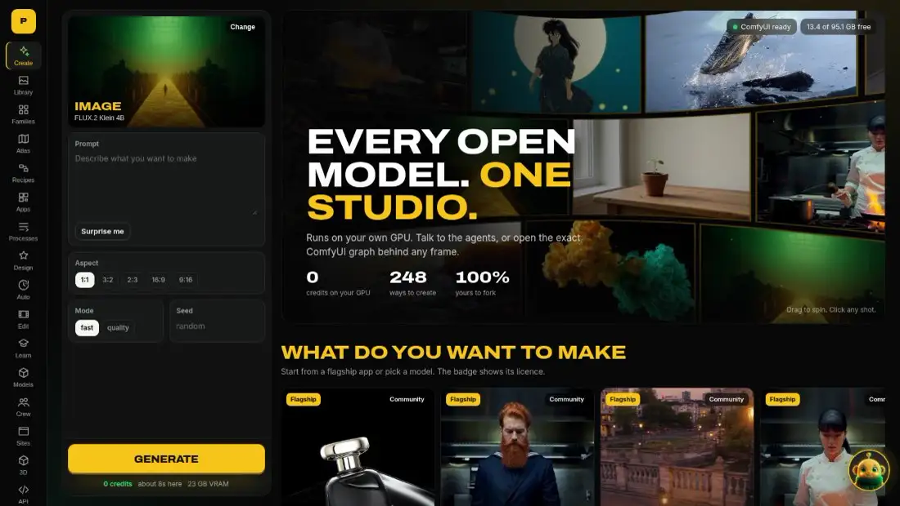
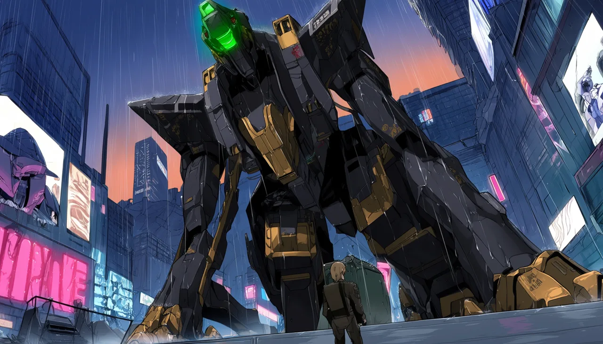
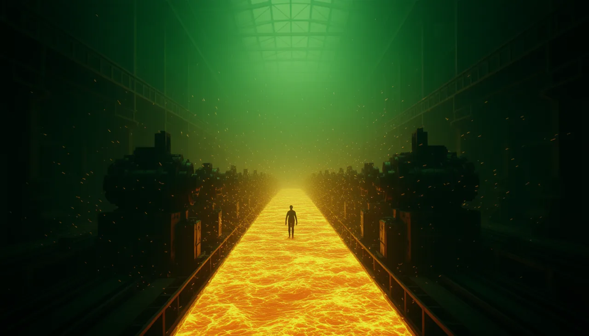
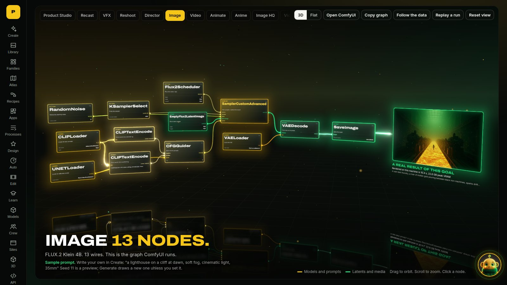
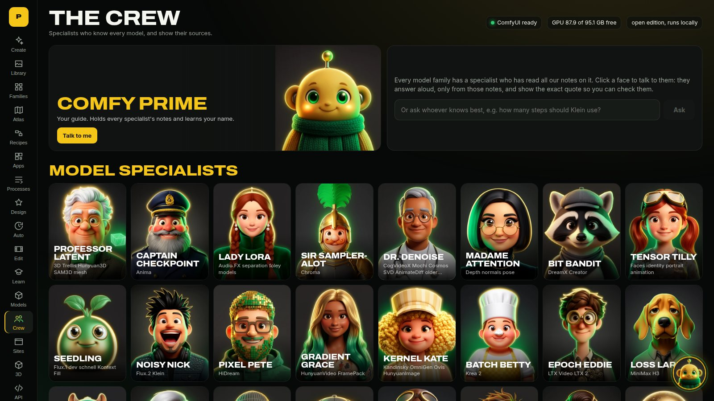
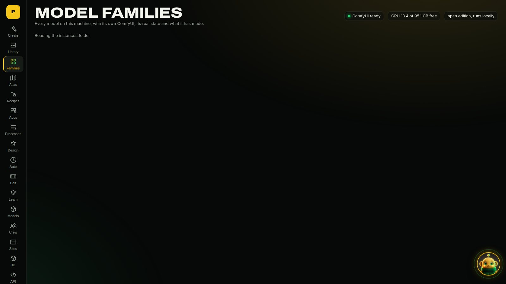
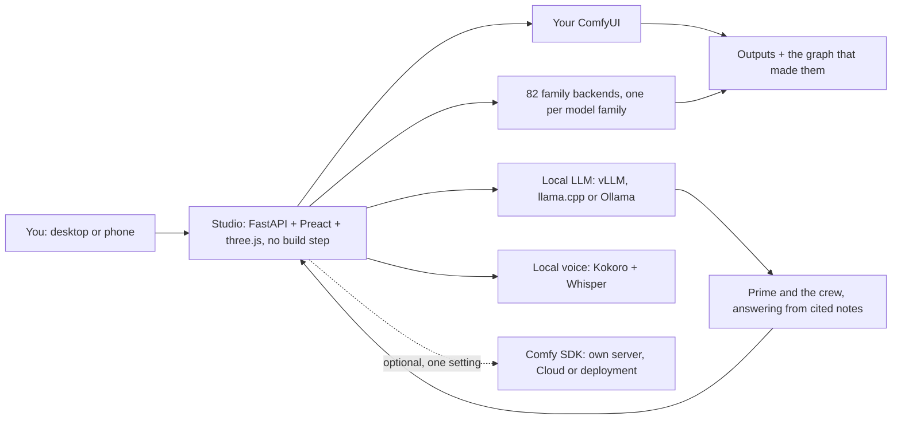

<div align="center">

# PARAMETRIC STUDIO

### Every open model. One studio. Your GPU.

The creative suite the closed apps promised, rebuilt in the open on ComfyUI.
Direct films, swap characters, make music videos and talk to a crew of AI specialists, with **0 credits** and the **real graph behind every frame**.

**[▶ Try the live demo](https://parametricparadigm.github.io/ComfyUI_Parametric_Studio/)** &nbsp;·&nbsp; **[🎬 Watch the 2-minute video](https://github.com/parametricparadigm/ComfyUI_Parametric_Studio/releases/download/demo/ParametricStudio_demo.mp4)** &nbsp;·&nbsp; **[⚡ Install](#install)** &nbsp;·&nbsp; **[🧠 What's inside](#whats-inside)**



<sub>That wall is live video from this studio's own renders, curved around you in three.js. Drag it. Click any shot to see how it was made.</sub>

</div>

---

## Why this exists

Closed AI video apps give you a prompt box and hide everything else. ComfyUI gives you everything, and a blank canvas. **Parametric Studio is both at once:** a form anyone can use, and one click from the exact ComfyUI graph that made the result. It runs on your machine, it reads your machine, and it teaches you how it all works while you use it.

| | Closed creative suites | Parametric Studio |
|---|---|---|
| **Cost per render** | Credits | **0 on your own GPU** |
| **How a result was made** | Hidden | **The real graph, in 3D, every time** |
| **Which models** | The ones they sell you | **82 model families, SD 1.5 to today** |
| **Your files and prompts** | On their servers | **Stay on your machine** |
| **Help** | A docs page | **A crew of characters that answer from cited notes, out loud** |
| **Can you fork it?** | No | **Yes: AGPL-3.0** |

## The apps

Named after what you want to do, not which node to wire.

| App | What it does | Core model |
|---|---|---|
| **Recast** | Swap the character in a video and keep the performance, scene and sound | MiniMax H3 |
| **VFX** | Flood a street, clear a plate, turn day to night, pull a matte | LTX-2.5 with IC-LoRAs |
| **Director** | Direct a shot like a film set: camera move, lens, light, mood, first and last frame | MiniMax H3 |
| **Reshoot** | A new take of your clip with a new camera move, from its first frame | MiniMax H3 |
| **Product Studio** | Your product, shot like an ad: pick the set and the light | FLUX.3 Klein |
| **Music Video Maker** | A song, the shots and the cut, on the beat | MiniMax Music 3 + H3 |
| **One sentence to a short film** | Plan, character, shots, score and edit from a single line | Klein + H3 + Music 3 |

Plus Image, Image HQ, Anime, Video, Animate, Video + Sound and Music as direct goals on FLUX.2 Klein, FLUX.3 Klein, Anima, Wan 2.2, LTX-2.5, MiniMax H3 and MiniMax Music 3.

<table><tr>
<td><a href="studio/web/showcase/v_h3_dragon.mp4"></a><br><sub><b>MiniMax H3</b>: dragon, with sound</sub></td>
<td><a href="studio/web/showcase/v_ltx_shatter.mp4"></a><br><sub><b>LTX-2.5</b>: shards into butterflies</sub></td>
<td><a href="studio/web/showcase/recast_chef.mp4"></a><br><sub><b>Recast</b>: same scene, new character</sub></td>
</tr><tr>
<td><br><sub><b>Anima</b>: mecha in the rain</sub></td>
<td><br><sub><b>FLUX.2 Klein</b>: 10 seconds on one GPU</sub></td>
<td><a href="studio/web/showcase/v_ltx_ink.mp4"></a><br><sub><b>LTX-2.5</b>: gold and emerald ink</sub></td>
</tr></table>

<sub>Every image above is a real, unedited output from this repo's workflows. Prompt, time and peak VRAM are on each tile in the app.</sub>

## What's inside

### See inside every shot
Open **Pro** and the exact ComfyUI graph appears in 3D, with data flowing along its wires. Click a node for a plain-language explanation. During a render it lights up node by node. The same graph runs when you press Generate, and you can copy it into ComfyUI.



### A crew you can talk to
**Comfy Prime** greets you, learns your name, and drives the studio for you, but never starts a render without your say. 37 specialists answer questions **only from notes, and show the quote**. Push to talk with local Whisper, hear replies in local Kokoro voices. Nothing leaves your machine.



### Every model family, with its own backend
82 families, from **Stable Diffusion 1.5, SDXL and SD3** through **FLUX, Wan, HunyuanVideo, Mochi, LTX and MiniMax H3**, plus 3D, audio and utility models. Each has its own isolated ComfyUI instance with its own custom nodes and model view, started on demand behind a VRAM check and stopped when idle. Every family shows its true state: rendered, ready, or exactly what to download.



### Designers
Whole concept sheets from a few choices: **Character, Fashion, Vehicle**, plus setting, animal, plant, hair, nails, furniture, costume and print-on-demand products. Original designs only: no brands, logos or real makes.

### AI video editing
Remove objects, upscale, slow motion, extend a clip, restyle with pose or depth, change the camera, fill and outpaint, edit by instruction, then cut it together on a timeline.

### ComfyUniversity
Levels 100 to 400, from *what happens when you press Queue* to *building and measuring models*: latent space, attention, flow matching, CFG, precision. Each lesson has a lab that runs on your CPU and prints real numbers, and a quiz. Audited lessons cite their sources; the rest carry a visible Draft banner until they earn it. Interactive graph-building walkthroughs are coming soon.

### Atlas: the history of generative AI
131 models across 8 eras, from the first VAEs and GANs to today: what each was, why it mattered, its licence, whether it runs here, and a button to use it. We don't discriminate.

### Recipes and processes
**Recipes** chain models into one click and pass outputs along. **Processes** lists 98 production methods with their guides. Most open a real tool or family page here today; the rest are marked Coming soon.

### Apps: every graph in one place
The 18 studio graphs, the recipes and more than 200 family graphs, searchable, each one click from its form. If a graph needs a model you don't have, its page says what to download.

### It reads your box
The installer and planner look at your GPU, RAM and disk and offer what fits: GPU, offload, or not on this machine. **Calibrate** runs a small render for each model and uses the real seconds and VRAM from then on. The crew's own LLM is picked by tier, from a 2B model on a CPU to a 27B model on a big card, with exact GGUF files and settings. Choose **stable or nightly** ComfyUI at install.

### Runs your way
- **Press Download:** each app shows what it needs and fetches only that. No 500 GB surprise.
- **Attach your ComfyUI:** already have one? Point the studio at it.
- **Set and forget:** schedule creations with cron, on idle only.
- **On your phone:** add it to your home screen over Tailscale, with private HTTPS and a QR code. Your GPU does the work.
- **Comfy SDK:** the same graphs through Comfy's official SDK, on your own server, Comfy Cloud or a deployment, with one setting.

### 578 custom nodes, including a new V3 pack
The `PSN_` nodes load in about 0.07 s thanks to lazy imports. The new V3 flagship pack:

| Node | What it does |
|---|---|
| **VRAM Gate** | Stops a graph with a plain reason when free VRAM is too low, instead of crashing mid-render |
| **Director Prompt** | Pick a camera move and its own controls appear; composes the whole shot |
| **Recast Prompt** | Writes the reference-tagged swap instruction for H3 |
| **Shot List** | Grows one slot per shot, then expands into a render subgraph for each |
| **Latent Inspector** | Look inside a latent: channel grid, PCA colour, histograms, stats |
| **Graph Proof** | Saves a hash and the settings next to every output |

More in [docs/NODES.md](docs/NODES.md).

## Built for the Open Source Higgsfield contest

| Prize | | How this entry answers it |
|---|---|---|
| **Best Overall** | ✅ | A complete studio: apps, 82 model backends, agents, editing, teaching, installer, and all of it open |
| **Most Innovative** | ✅ | Watching the real graph run in 3D, agents that answer from cited notes, an isolated backend per family, box-aware calibration, a novel V3 node pack |
| **Most Viral** | ✅ | One sentence to a short film, a music video maker, a Share button on every result, a phone app, and a [demo you can try right now](https://parametricparadigm.github.io/ComfyUI_Parametric_Studio/) |
| **Open Weights Only** | ✅ | The default edition uses open-weights models only: no partner nodes, no closed APIs, enforced by a test |
| **VFX with LTX** | ✅ | The VFX app and its workflow have LTX-2.5 as the core model |
| **Built with FLUX** | ✅ | Product Studio and Image HQ have FLUX.3 Klein as the core model |
| **Built with MiniMax H3** | ✅ | Recast, Director, Reshoot and first/last frame have MiniMax H3 as the core model |

## Install

**One command, sized to your machine.** See what it would do first:

```bash
git clone https://github.com/parametricparadigm/ComfyUI_Parametric_Studio.git
cd ComfyUI_Parametric_Studio
python3 install.py --dry-run     # shows what fits this box, changes nothing
python3 install.py               # or --channel nightly, or --goals image,video
```

**Already run ComfyUI?** You only need the studio:

```bash
uv sync
COMFYUI_URL=http://127.0.0.1:8188 uv run python -m studio.server
# open http://localhost:8310
```

Full details, including Windows, Mac and what has and hasn't been tested on each, are in **[INSTALL.md](INSTALL.md)**. Models and their licences are in **[MODELS.md](MODELS.md)**; they are not in this repo, and some have their own terms and regional limits, so please read them.

## How it fits together



| Folder | What lives there |
|---|---|
| `studio/` | The app: API, goals, recipes, crew, university, designers |
| `studio/web/` | The front end: Preact, htm and three.js, vendored, with no build step |
| `workflows/` | The API-format ComfyUI graphs behind every app |
| `psn_nodes/` | The custom node pack |
| `psn/` | Family instances, agents, connectors |
| `tests/` | More than 4,000 tests |

## Credits

**Made by Parametric Paradigm.**

**Made on one box:** NVIDIA RTX PRO 6000 Blackwell Workstation Edition (96 GB), AMD Ryzen 9 9950X 16-Core Processor (32 threads), 123 GB RAM, 4 TB NVMe, Ubuntu 24.04.5 LTS. Every render in this repo came from that one machine, except the samples marked as coming from ComfyUI's library.

Built with [ComfyUI](https://github.com/comfyanonymous/ComfyUI), with Claude Code (Anthropic) and a local Qwen model writing alongside. Recast builds on the method published by Comfy-Org in `comfy-openjutsu` and Akatz Labs' H3 Character Swap. Thanks to every team that releases open weights: see [docs/CREDITS.md](docs/CREDITS.md) and [THIRD_PARTY_NOTICES.md](THIRD_PARTY_NOTICES.md).

## Licence

**AGPL-3.0-or-later.** Use it, fork it, improve it. If you ship or host a changed version, you share your source too. See [LICENSE](LICENSE). Models keep their own licences.
